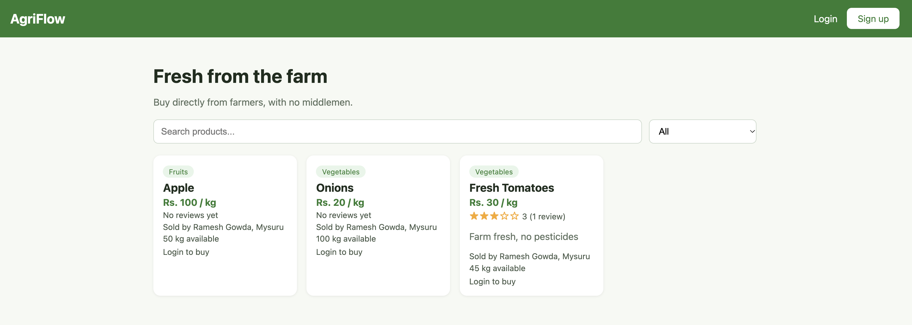
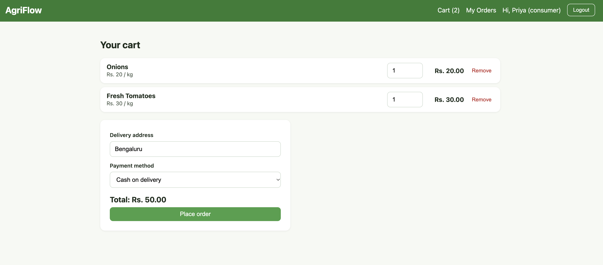
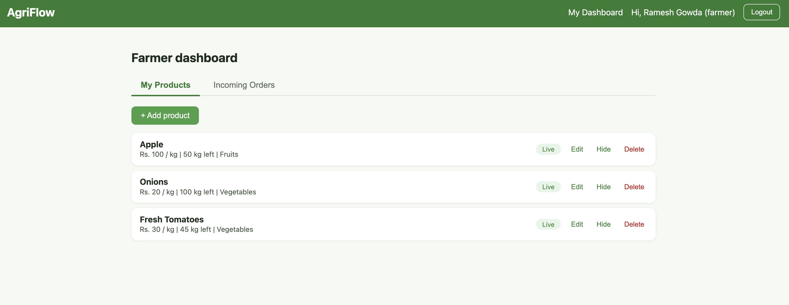
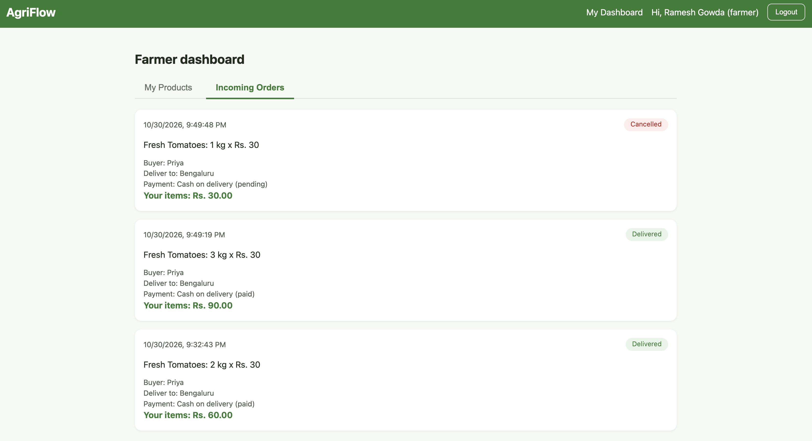

# AgriFlow

A Direct Farm-to-Consumer web platform that connects farmers with buyers and removes middlemen. Farmers list their produce at their own prices, and consumers browse, order and review it directly.

Built as a mini project for Innovation and Design Thinking (B25IDL108), CSE, Rajarajeswari College of Engineering.

## Problem

Farmers usually sell through several intermediaries (local traders, wholesalers, distributors, retailers). Each one adds a margin, so farmers earn less and consumers pay more. AgriFlow gives farmers a direct channel to customers.

## Features

**Farmer**
- Sign up and log in
- Add, edit, hide and delete products
- See incoming orders and update them: accepted, shipped, delivered

**Consumer**
- Sign up and log in
- Browse, search and filter products by category
- See average ratings on each product
- Add to cart and place an order (cash on delivery or simulated online payment)
- View order history and cancel an order before it is accepted
- Review a product after it is delivered

## Tech stack

| Layer | Technology |
|---|---|
| Frontend | React (Vite), React Router |
| Backend | Python (Flask) |
| Database and login | Supabase (PostgreSQL) |
| Hosting (optional) | Vercel |

## How it works

```
Browser (Farmer / Consumer)
        |
   React frontend  (port 5173)
        |   /api requests
   Flask backend   (port 5001)
        |
   Supabase (Auth + PostgreSQL)
```

## Database tables

`profiles`, `products`, `orders`, `order_items`, `reviews`

## Screenshots

| Home | Cart |
|---|---|
|  |  |

| Farmer products | Farmer orders |
|---|---|
|  |  |

## Running it locally

You need Python 3.10+, Node.js 18+ and a free Supabase project.

### 1. Clone

```bash
git clone https://github.com/AmithChatriki/agriflow.git
cd agriflow
```

### 2. Database

1. Create a project at supabase.com.
2. Open the SQL Editor and run the table setup script from `database/schema.sql`.

### 3. Backend

```bash
python3 -m venv .venv
source .venv/bin/activate
pip install -r requirements.txt
cp .env.example .env
```

Open `.env` and fill in your Supabase details:

```
SUPABASE_URL=your_project_url
SUPABASE_SERVICE_KEY=your_secret_key
```

Never commit `.env`. It is already listed in `.gitignore`.

Start the server:

```bash
python backend/app.py
```

### 4. Frontend

In a second terminal:

```bash
cd frontend
npm install
npm run dev
```

Open http://localhost:5173.

### 5. Try it

1. Sign up as a farmer and add a product.
2. Log out, sign up as a consumer, and place an order.
3. Log back in as the farmer and move the order to delivered.
4. Log in as the consumer again and leave a review.

## API overview

| Method | Endpoint | Who |
|---|---|---|
| POST | `/api/auth/signup`, `/api/auth/login` | Everyone |
| GET | `/api/products` | Everyone |
| POST, PUT, DELETE | `/api/products` | Farmer |
| GET | `/api/farmer/products`, `/api/farmer/orders` | Farmer |
| PUT | `/api/orders/<id>/status` | Farmer |
| POST, GET | `/api/orders` | Consumer |
| PUT | `/api/orders/<id>/cancel` | Consumer |
| GET, POST | `/api/products/<id>/reviews` | Read: everyone, write: consumer |

## Notes and limitations

- Online payment is simulated. No real payment gateway is connected.
- One order has one status, even if the cart contains products from different farmers.
- This is a college project and has not been hardened for production use.

## Team

Add team member names here.
